  

           

**Data Engineer y desarrolladora backend Java** · +5 años · España (remoto).
Construyo pipelines de datos, servicios Spring Boot y equipos de **agentes de IA** que programan con TDD, CI y revisión, y miden su precisión estimando.

- 📈 **Datos y ML:** pipelines en AWS · dbt + DuckDB · pandas · LightGBM · series temporales con validación honesta
- 🤖 **IA:** RAG local, visión por computador (OpenCV), Stable Diffusion + ControlNet, Claude Code con subagentes
- 🎓 **Certificación:** AWS Certified AI Practitioner · 📚 **Ahora:** AWS Cloud Practitioner (nov 2026)
- 💬 **Pregúntame por:** pipelines de datos, Spring/WebFlux, trabajar con equipos de agentes

## ✨ Proyectos destacados

### ☁️ [aws-data-pipeline](https://github.com/AlbaAsca/aws-data-pipeline) · ingeniería de datos en AWS
**Lambda → S3 (Parquet) → dbt + DuckDB → panel**, con Terraform, alarmas, DLQ y despliegue desde GitHub por
**OIDC sin claves**. Construido en LocalStack a coste 0 y probado en una cuenta real de AWS por **< 0,01 $**.

### ☕ [WebFluxTaskManager](https://github.com/AlbaAsca/WebFluxTaskManager) · backend Java reactivo
API REST de tareas con **Java 21, Spring Boot 4 y WebFlux** sobre MongoDB reactivo: HATEOAS, errores RFC 9457,
seguridad por roles y **cambios en tiempo real por Server-Sent Events**. Tests con `@WebFluxTest`, `StepVerifier`
y **Testcontainers** contra un MongoDB real en el CI.

### 📈 [store-sales-forecasting](https://github.com/AlbaAsca/store-sales-forecasting) · series temporales en Kaggle
Previsión de 1.782 series con validación temporal honesta: **0,45751 → 0,38839 RMSLE (−15 %)** en 10 versiones.
45 ideas probadas como experimentos con el criterio fijado antes de medir, también las 30 que no entraron.

### 🤖 [agent-board](https://github.com/AlbaAsca/agent-board) · un equipo de agentes de IA sobre un kanban
Consultor, arquitecto, desarrollador, tester…: cada tarea guarda el tiempo estimado frente al real y el panel calibra
las estimaciones.

#### 🧰 Más
| Proyecto | Qué hace |
|---|---|
| [agent-project-template](https://github.com/AlbaAsca/agent-project-template) | Desarrollo autónomo con agentes: orquestador → implementer → reviewer, TDD estricto y CI |
| [til](https://github.com/AlbaAsca/til) | Notas cortas de lo que aprendo cada día |
| floorplan-studio *(privado, demo pronto)* | Del plano a la estancia amueblada: paredes, escala por OCR e imagen con IA local |

<table><tr><td valign="top" width="50%">

#### 🔨 Trabajo reciente
<!-- recent_work starts -->
- **[aws-data-pipeline](https://github.com/AlbaAsca/aws-data-pipeline)** — [style: switch charts, dashboard and diagrams to the Tokyo…](https://github.com/AlbaAsca/aws-data-pipeline/commit/b23d5c5b5fd1b611e40f4caa72e25cc90e93b3d6) · 2026-11-02
- **[WebFluxTaskManager](https://github.com/AlbaAsca/WebFluxTaskManager)** — [docs: add real-time demo GIF to README](https://github.com/AlbaAsca/WebFluxTaskManager/commit/72749b69071995d842de41165c158170b018fa41) · 2026-11-02
- **[store-sales-forecasting](https://github.com/AlbaAsca/store-sales-forecasting)** — [docs(learnings): record Kaggle outcomes of V-037, V-038, …](https://github.com/AlbaAsca/store-sales-forecasting/commit/d99a9a0f657f3f77664c347ecb940b68902f03e3) · 2026-11-01
- **[agent-board](https://github.com/AlbaAsca/agent-board)** — [perf: per-role turn caps for autonomous agents](https://github.com/AlbaAsca/agent-board/commit/8163dcca785f5a60ec8f0eeb0ecf520fe260e66a) · 2026-10-18
- **[agent-project-template](https://github.com/AlbaAsca/agent-project-template)** — [docs: add English summary to README](https://github.com/AlbaAsca/agent-project-template/commit/6aa61f2fe0c06a4f30ff2fbfb05538a3f6720c84) · 2026-10-14
<!-- recent_work ends -->

</td><td valign="top" width="50%">

#### 📝 Aprendido hoy ([todo](https://github.com/AlbaAsca/til))
<!-- til starts -->
- [Un holdout local es una alarma, no un veredicto](https://github.com/AlbaAsca/til/blob/main/ml/holdout-local-no-es-veredicto.md) · 2026-11-01
- [`linear_tree` en LightGBM extrapola… también lo que no debe](https://github.com/AlbaAsca/til/blob/main/ml/linear-tree-extrapola-temporadas.md) · 2026-11-01
- [Usar mplcyberpunk con matplotlib ≥ 3.11](https://github.com/AlbaAsca/til/blob/main/python/mplcyberpunk-con-matplotlib-311.md) · 2026-11-01
- [Borrar datos privados de todo el historial de git](https://github.com/AlbaAsca/til/blob/main/git/borrar-datos-privados-del-historial.md) · 2026-10-14
<!-- til ends -->

</td></tr></table>

  
  

🇬🇧 Data Engineer & Java backend developer (5+ yrs), Spain, remote. AWS Certified AI Practitioner. Data pipelines, Spring Boot services and AI agent teams that ship with TDD and CI. Featured: a reactive Java 21 / Spring Boot 4 WebFlux API with real-time SSE, an end-to-end AWS data pipeline (Lambda, S3, dbt + DuckDB, Terraform, GitHub OIDC; built on LocalStack, < $0.01 on real AWS) and time-series forecasting on Kaggle Store Sales (RMSLE 0.457 → 0.388) with honest backtesting.
